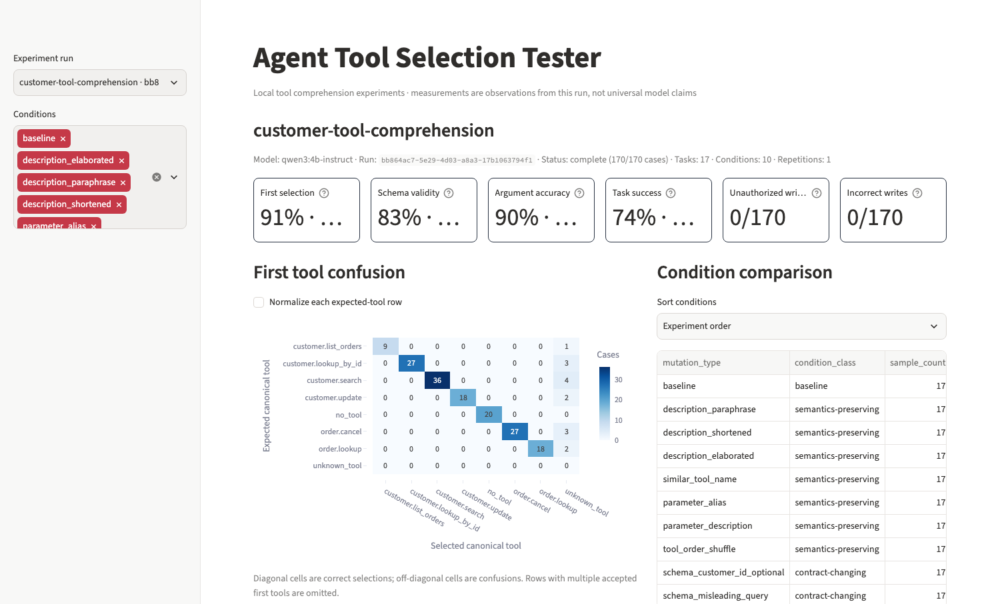
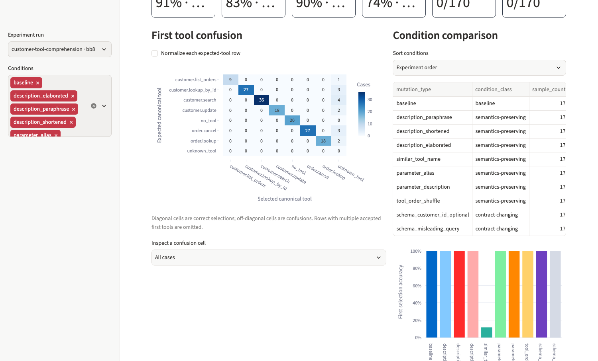
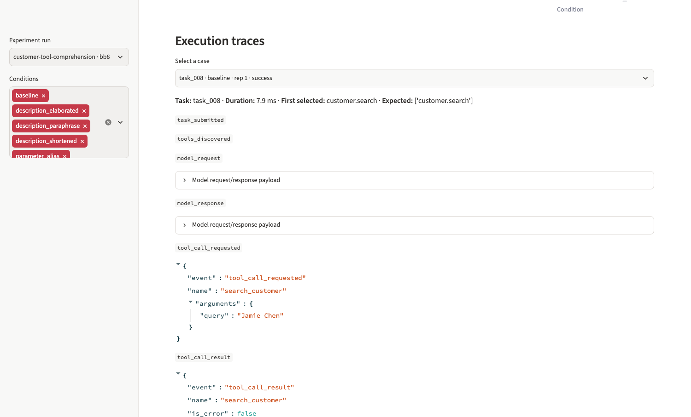
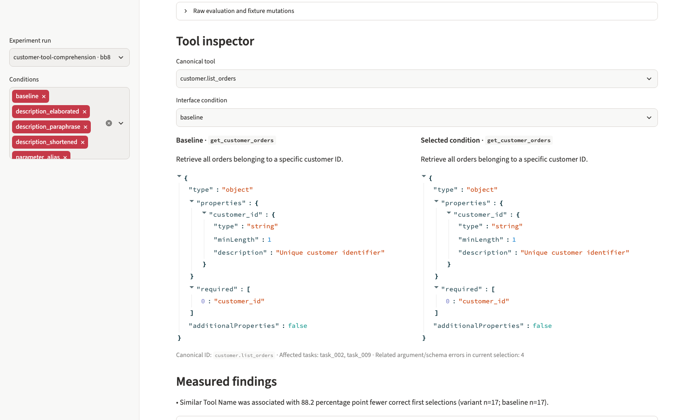
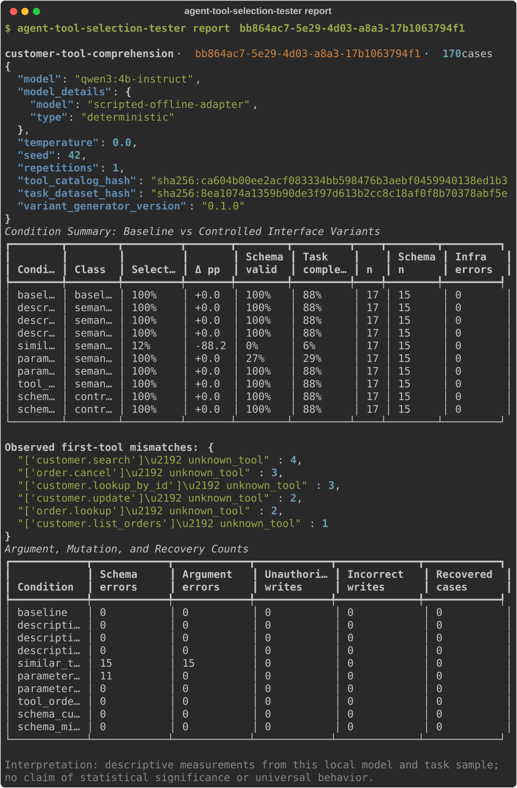
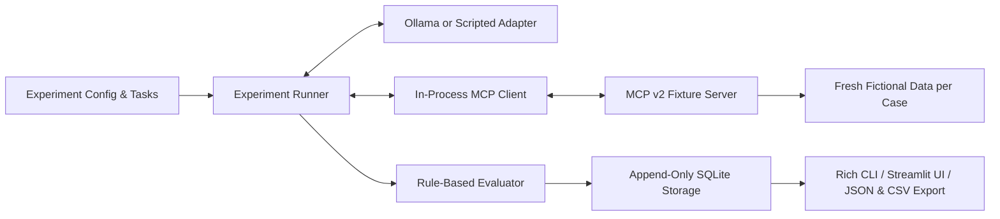

# Agent Tool Selection Tester

[](./LICENSE) [](https://github.com/ranajahanzaib/agent-tool-selection-tester/actions/workflows/ci.yml) [](./pyproject.toml)

> **Empirical behavioral evaluation companion for Model Context Protocol (MCP) tool integration.** Measure how local language models select, parameterize, and execute related tools when exposed to controlled variations in tool names, descriptions, parameter aliases, or catalog ordering.

---



---

## The Problem

MCP contract tests confirm whether a server adheres to protocol standards and whether tools produce valid schemas. However, contract tests **cannot predict how an LLM will actually behave**:

- Will a model confuse `get_customer` (ID lookup) with `search_customer` (fuzzy search)?
- Does renaming a tool parameter from `customer_id` to `id` degrade schema validity or argument extraction?
- Does elaborating or shortening a tool's description improve first-turn tool accuracy or increase hallucinations?
- Does catalog presentation order bias which tool gets invoked first?

**Agent Tool Selection Tester** closes this gap. It hosts an in-process MCP server with isolated fixture data per case, connects via an in-process MCP client, discovers dynamic schemas, and bridges them to Ollama's structured tool-calling API or a deterministic offline adapter to measure comprehension across controlled, single-variable mutations.

---

## Key Features

- **Real In-Process MCP Engine:** Discovers and calls tools through actual MCP SDK v2 `tools/list` and `tools/call` operations.
- **Canonical Tool Identities:** Tool capabilities remain identity-stable across public alias variations and schema mutations.
- **Controlled Interface Variants:** Tests 7 semantic-preserving mutations (paraphrased description, shortened description, elaborated description, similar tool names, parameter aliases, parameter descriptions, tool order shuffling) and 2 contract-changing mutations.
- **Paired Tasks & Fresh State:** 17 representative customer/order tasks executed across repetitions with per-case fixture rollbacks.
- **Rule-Based Multi-Dimensional Scoring:** Evaluates first-tool selection, schema validity, argument accuracy, task completion, and unauthorized write attempts.
- **Interactive Streamlit Dashboard:** Plotly confusion matrix heatmap, condition comparison tables & delta charts, step-by-step execution traces, and side-by-side tool schema inspector.
- **Rich Terminal CLI:** Fast local execution with live progress bars, summary tables, trace inspection, and JSON/CSV export.
- **Offline Deterministic Mode:** Full automated pipeline verification and dashboard seeding without requiring an active Ollama instance.

---

## Visual Showcase

### Interactive Analysis Dashboard

The local Streamlit application (`agent-tool-selection-tester ui`) enables deep analysis of stored runs, comparing the baseline against controlled interface mutations:


_First-tool confusion matrix heatmap and condition comparison bar chart highlighting accuracy variations across interface mutations._

### Step-by-Step Execution Traces

Inspect raw model requests, assistant responses, MCP discovery events, and rule-based evaluation diagnostics for any specific task run:


_Detailed case execution timeline showing prompt submission, MCP tool discovery, model requests, and tool execution._

### Side-by-Side Tool Schema Inspector

Compare baseline JSON schemas against any interface condition side-by-side, along with empirical observations:


_Side-by-side schema comparison between baseline tool definitions and mutated public variants._

### Command-Line Interface & Reports

Run experiments, inspect summaries, and export datasets directly from your terminal:


_Rich terminal output from `agent-tool-selection-tester report`, displaying condition deltas, schema error breakdowns, and first-tool mismatches._

---

## Requirements and Installation

- **Python:** 3.12 or newer
- **Package Manager:** [uv](https://docs.astral.sh/uv/) (recommended) or pip
- **LLM Runtime (for live model inference):** [Ollama](https://ollama.com/)

```bash
git clone https://github.com/ranajahanzaib/agent-tool-selection-tester.git
cd agent-tool-selection-tester
uv sync --extra dev
```

Verify your environment using the built-in diagnostic tool:

```bash
uv run agent-tool-selection-tester doctor
```

---

## Quick Start

### 1. Offline Mode (No Ollama Required)

Execute the full 170-case evaluation suite against the deterministic scripted adapter:

```bash
# Run 17 tasks across baseline and 9 controlled mutations
uv run agent-tool-selection-tester run --offline --repetitions 1

# List stored runs
uv run agent-tool-selection-tester runs

# Inspect a detailed terminal report
uv run agent-tool-selection-tester report <run-id>

# Export cases to JSON or CSV
uv run agent-tool-selection-tester export <run-id> --format json -o results.json
uv run agent-tool-selection-tester export <run-id> --format csv -o results.csv

# Launch the visual dashboard
uv run agent-tool-selection-tester ui
```

### 2. Live Local Model Experiments (via Ollama)

Pull your preferred tool-calling model and run the experiment:

```bash
# Pull model
ollama pull qwen3:4b-instruct

# Run the default suite (17 tasks, 3 repetitions, baseline + 9 mutations)
uv run agent-tool-selection-tester run

# Run with a custom model or repetition count
uv run agent-tool-selection-tester run examples/customer-tools.yaml --model qwen3:8b --repetitions 2
```

### 3. Bundled Synthetic Demonstration

To explore the dashboard immediately without running an experiment:

```bash
uv run agent-tool-selection-tester demo
```

_(Use `--no-ui` to seed the database without automatically opening the browser.)_

---

## CLI Reference

| Command    | Description                                                          | Example                                                     |
| :--------- | :------------------------------------------------------------------- | :---------------------------------------------------------- |
| `doctor`   | Check local runtime prerequisites, MCP SDK, and storage writeability | `agent-tool-selection-tester doctor`                        |
| `examples` | List bundled experiment suites and configuration paths               | `agent-tool-selection-tester examples`                      |
| `run`      | Execute experiment against Ollama or offline scripted adapter        | `agent-tool-selection-tester run --offline`                 |
| `runs`     | List all locally stored experiment runs in SQLite                    | `agent-tool-selection-tester runs`                          |
| `report`   | Generate formatted terminal summary with confusion statistics        | `agent-tool-selection-tester report <run-id>`               |
| `export`   | Export raw evaluation traces to JSON or CSV format                   | `agent-tool-selection-tester export <run-id> --format json` |
| `ui`       | Launch the local Streamlit and Plotly interactive dashboard          | `agent-tool-selection-tester ui`                            |
| `demo`     | Seed an illustrative synthetic run and launch dashboard              | `agent-tool-selection-tester demo --no-ui`                  |

---

## Experiment Configuration

Experiments are configured via YAML files (see [`examples/customer-tools.yaml`](examples/customer-tools.yaml) and [`examples/customer-tasks.yaml`](examples/customer-tasks.yaml)):

```yaml
name: customer-tool-comprehension
description: Evaluate whether local models distinguish related customer and order operations.
tasks_file: customer-tasks.yaml

model:
  provider: ollama # "ollama" or "scripted"
  name: qwen3:4b-instruct
  temperature: 0
  seed: 42
  max_tool_rounds: 4
  timeout_seconds: 120

experiment:
  repetitions: 3
  variant_seed: 42
  include_baseline: true

mutations:
  - type: description_paraphrase
  - type: description_shortened
  - type: description_elaborated
  - type: similar_tool_name
  - type: parameter_alias
  - type: parameter_description
  - type: tool_order_shuffle
  - type: schema_customer_id_optional
  - type: schema_misleading_query
```

### Supported Mutation Conditions

#### Semantic-Preserving Mutations

1. **`description_paraphrase`:** Rephrases the tool documentation without altering semantic scope.
2. **`description_shortened`:** Condenses documentation to minimal imperative summaries (e.g., "Get customer.").
3. **`description_elaborated`:** Appends explicit boundary guidance and exclusion criteria.
4. **`similar_tool_name`:** Uses near-synonym public tool names (e.g., `find_customer` instead of `search_customer`).
5. **`parameter_alias`:** Exposes public parameter aliases (e.g., renaming `customer_id` to `id`).
6. **`parameter_description`:** Modifies parameter documentation level of detail.
7. **`tool_order_shuffle`:** Seeds tool ordering variations in the presented MCP catalog.

#### Contract-Changing Mutations

8. **`schema_customer_id_optional`:** Makes a required identifier field optional in the public schema.
9. **`schema_misleading_query`:** Adds an optional fuzzy search parameter to a direct lookup tool.

---

## Evaluation Metrics

- **First Selection Accuracy:** Whether the initial canonical tool matches an accepted plan (or no tool for clarification tasks).
- **Schema Validity:** Whether argument payloads validate against the active JSON Schema offered to the model.
- **Argument Correctness:** Whether provided argument values match accepted plan parameters (aliases normalized).
- **Task Success:** Whether observed MCP tool executions satisfy an accepted task completion plan.
- **Unauthorized Writes:** Flags cases where mutation tools (e.g., `update_customer`, `cancel_order`) were invoked on read-only tasks.
- **Confusion Counts:** Cross-tabulates expected canonical tool against selected tool to pinpoint ambiguous boundaries.

> **Note on Interpretation:** Results represent descriptive empirical observations for the specified local model and task distribution under controlled conditions; they should not be construed as universal benchmarks or statistical claims across all agent domains.

---

## Architecture

The system operates entirely locally with clear component separation:



- **`core.py`:** Pydantic domain models, deterministic customer/order fixture handlers, controlled variant generators, and evaluation rules.
- **`mcp_runtime.py`:** Exposes dynamic schemas through Model Context Protocol (MCP) Python SDK v2.
- **`runner.py`:** In-process MCP client runner with turn-bounded execution and provider bridging.
- **`experiment.py`:** Multi-condition runner managing seeds, task rotation, and reproducibility manifests.
- **`storage.py`:** Append-only SQLite storage (`results.sqlite3`) with automatic fallback for restricted environments.
- **`dashboard.py`:** Streamlit and Plotly analytical UI.
- **`cli.py`:** Typer and Rich command-line interface.

For additional architectural details, see [`docs/architecture.md`](docs/architecture.md), [`docs/experiment-format.md`](docs/experiment-format.md), and [`docs/methodology.md`](docs/methodology.md).

---

## Testing & Quality

Run the comprehensive test suite and code quality linters:

```bash
# Run unit and integration tests (24 tests across core, MCP, runner, and CLI)
uv run pytest

# Check code formatting and linting
uv run ruff check .

# Check static typing
uv run mypy
```

---

## Contributing and License

Contributions are welcome! Please review [`CONTRIBUTING.md`](CONTRIBUTING.md) and the [Code of Conduct](CODE_OF_CONDUCT.md) before submitting pull requests.

Released under the [MIT License](LICENSE).
